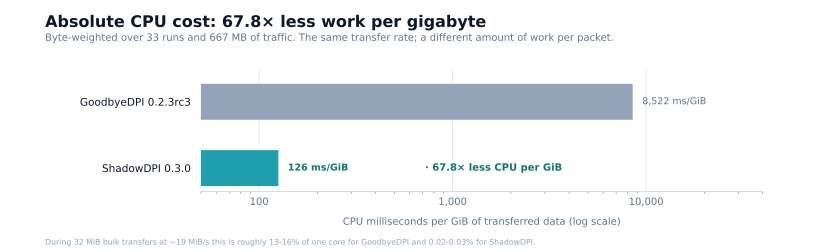
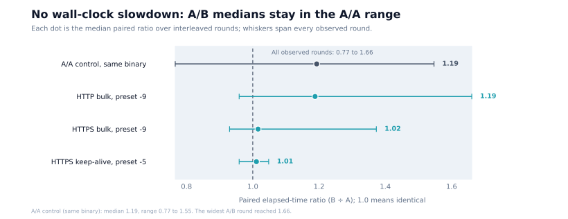
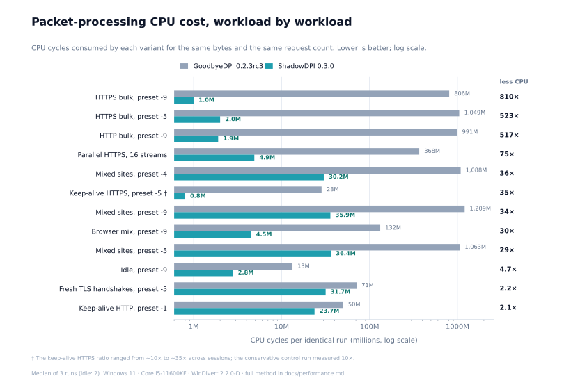

<p align="center">
  
</p>

<h1 align="center">ShadowDPI</h1>

<p align="center">
  <strong>Modern and lightweight DPI circumvention utility for Windows x64.</strong>
</p>

<p align="center">
  <a href="https://github.com/amcique/ShadowDPI/actions/workflows/build.yml"></a>
  <a href="https://github.com/amcique/ShadowDPI/releases"></a>
  <a href="https://github.com/amcique/ShadowDPI/releases"></a>
  <a href="#build-from-source-msvc-x64"></a>
  <a href="LICENSE"></a>
</p>

<p align="center">
  <strong>English</strong> · <a href="README.ru.md">Русский</a> · <a href="README.tr.md">Türkçe</a>
</p>

ShadowDPI changes the first packets of a connection so that deep packet
inspection (DPI) has a harder time recognizing it. It runs as a normal program
on top of WinDivert, so your traffic stays encrypted and apps keep connecting
to the real server.

It works with HTTP and HTTPS, and it can block QUIC so browsers switch to TCP. A
built-in scanner tries different settings against sites you choose. It needs
Administrator rights because it loads a kernel driver. It is not a VPN: your IP
address does not change, and your traffic is not sent through another server.

## Quick start

1. Download the [latest release](https://github.com/amcique/ShadowDPI/releases).
2. Unpack it anywhere. The archive already contains `install.ps1`,
   `WinDivert.dll`, and `WinDivert64.sys`.
3. From an elevated PowerShell in the unpacked folder:

   ```powershell
   .\install.ps1 -Action install
   ```

That copies the files to `%ProgramFiles%\ShadowDPI`, registers an auto-start
`ShadowDPI` service with `-9`, and starts it. `-Action install -NoService`
copies the files without creating a service.

To try it without installing, run the executable directly from an elevated
prompt. With no arguments it applies `-9`, which is the right first attempt for
most providers:

```powershell
.\shadowdpi.exe
```

If the provider poisons DNS answers, either enable secure DNS in the browser or
redirect DNS at the packet layer:

```powershell
.\shadowdpi.exe -9 --dns-addr 77.88.8.8 --dns-port 1253
```

To upgrade, unpack the new release and run `.\install.ps1 -Action upgrade` from
that folder; existing service settings are kept. To change service arguments or
remove the service, use `-Action reconfigure` or `-Action uninstall`. When
updating by hand, replace `shadowdpi.exe`, `WinDivert.dll`, and
`WinDivert64.sys` together so their versions stay matched.

## Why ShadowDPI

- **Low CPU cost.** About 0.03% of one core on a busy 19 MiB/s link. The full
  comparison with GoodbyeDPI is in [Performance](#performance).
- **Nothing to undo.** If ShadowDPI stops, applications keep working. It does
  not install a certificate or change proxy settings.
- **A built-in strategy scanner.** DPI differs by provider and changes over
  time. `install.ps1 -Action scan` tests presets and option combinations
  against your own URL list and reports the first one that recovers everything.
- **C++20, with tests and a benchmark.** One executable and the bundled
  WinDivert driver; a platform-independent, unit-tested core; a thin Windows
  layer; parser parity tests against `WinDivertHelperParsePacket` with a
  randomized corpus; a parser benchmark with an enforced speedup floor in CI.
- **A public code review.** A 20-finding source review was completed and fixed
  before the first public release. The report is in
  [`docs/reviews/2026-11-source-review.md`](docs/reviews/2026-11-source-review.md).

## How it compares

| | ShadowDPI | GoodbyeDPI | Zapret | ByeDPI |
|---|---|---|---|---|
| Platform | Windows x64 | Windows | Linux, Windows (`winws`) | Cross-platform |
| Mechanism | WinDivert, transparent | WinDivert, transparent | netfilter / WinDivert desync | Local SOCKS5 proxy |
| Administrator required | Yes | Yes | Yes | No |
| Configuration | Presets, ~40 flags | Presets, flags | Config files and host lists | Flags plus a proxy client |
| Built-in strategy scanner | Yes | No | `blockcheck` | No |
| Measured CPU per GiB | **1× (baseline)** | 67.8× | not measured | not measured |

ShadowDPI and GoodbyeDPI were benchmarked head to head; Zapret and ByeDPI were
not, and "not measured" is not a claim of superiority; they solve the same
problem with different tradeoffs, and Zapret in particular exposes far more
desync options than ShadowDPI does. If ShadowDPI's presets do not fit your
provider, try them too. Method and caveats:
[docs/performance.md](docs/performance.md).

## What it does

- **Blocks passive DPI.** Injected redirects and TCP resets are dropped before
  they reach the application.
- **Defeats active DPI.** HTTP requests and TLS ClientHellos are split,
  reordered, and rewritten; optional decoy packets carry a short TTL, a bad
  checksum, or an old sequence number.
- **Handles QUIC.** `-9` drops QUIC/HTTP3 Initial packets so browsers fall back
  to TCP, where the other techniques apply.
- **Scopes the work.** A blacklist can limit the host-aware tricks to selected
  domains. The early SYN/ACK window-size step runs before the host name is
  known and therefore remains global to the handled ports.
- **Redirects poisoned DNS.** IPv4 and IPv6 resolver addresses can be replaced
  on the fly, with transaction-ID, question, and resolver validation.

## Performance

Compared with GoodbyeDPI v0.2.3rc3 on the same host, with the same workloads,
the same byte counts, and interleaved rounds, ShadowDPI used **67.8× less CPU
per gigabyte** while wall-clock transfer time stayed unchanged.



Both variants move data at the same speed. ShadowDPI uses far fewer CPU cycles
to do it, which leaves headroom for routers, VPNs, and other software on the
machine.



The A/A control runs the original binary in both slots. Its median ratio was
1.193 with a range of 0.766 to 1.547, so differences of tens of percent are
normal on this host. The A/B medians for HTTP, HTTPS, and keep-alive all fall
inside the A/A range; the paired CPU ratios (0.0023, 0.0011, 0.0911) do not.

### CPU cost for all twelve workloads



Bulk HTTPS transfers show 500-810× less CPU. The remaining workloads show
2-75×; the 67.8× byte-weighted figure above is the conservative aggregate.

Method, environment, the full matrix, latency distributions, and caveats are
in [docs/performance.md](docs/performance.md).

## Tuning

Presets are additive groups of options; later arguments override them.

| Preset | What it adds |
| --- | --- |
| `-1` to `-4` | Passive blocking plus HTTP Host tricks; TLS split is 2, 40, or off |
| `-5` | HTTP/TLS splitting, reverse order, and automatic fake TTL |
| `-6` | Splitting plus fake packets with a wrong TCP sequence number |
| `-7` | Splitting plus fake packets with a bad checksum |
| `-8` | Both wrong sequence and bad checksum |
| `-9` | `-8` plus QUIC blocking (the default) |

Useful variations:

```powershell
.\shadowdpi.exe -5                                  # if -9 is too aggressive
.\shadowdpi.exe -5 --blacklist C:\blocked.txt       # host-aware tricks only
.\shadowdpi.exe -9 --verbose                        # verbose diagnostics
.\shadowdpi.exe --help                              # options of this build
```

`-9` blocks QUIC deliberately. If an application needs QUIC and cannot fall
back to TCP, start from `-5` instead.

### Find a working strategy

Hand-picked presets are a starting point, not a guarantee. The strategy scanner
tests presets and option combinations against a list of URLs, using the same
baseline comparison as zapret's blockcheck. It starts one ShadowDPI process per
candidate, waits for `--ready-file`, probes the URLs with `curl.exe`, and
reports the first strategy that recovers every blocked URL without breaking a
working one.

```powershell
.\install.ps1 -Action scan -ScanLevel quick
.\install.ps1 -Action scan -UrlFile .\blocked.txt -ScanLevel standard -Json result.json
.\install.ps1 -Action scan -Urls wikipedia.org,x.com -DnsAddr 77.88.8.8 -DnsPort 1253
```

Scanning is also a choice in the `install.ps1` menu. Edit `tools\scan-urls.txt`
or pass `-Urls`. In an interactive session the scanner asks which DNS resolver
to use: Cloudflare, Google, another resolver, or the system resolver. Pass
`-DnsResolver system` to skip the question, or `-DnsAddr` when you need a
custom address and port. The scanner needs Administrator rights and `curl.exe`,
and it stops an installed running service for the baseline before starting it
again. Scan levels, result verdicts, JSON fields, and exit codes are documented
in [docs/scan.md](docs/scan.md).

The full option reference, alias table, blacklist format, and validation rules
are in [docs/cli.md](docs/cli.md). Installer actions, service settings, and
`install.json` are documented in [docs/install.md](docs/install.md).

## Under the hood

WinDivert intercepts packets at the Windows Filtering Platform and hands them
to user space. ShadowDPI parses the IP and TCP headers, decides whether the
packet belongs to a connection it should touch, rewrites or splits it,
recalculates checksums, and reinjects it. Separate drop filters handle passive
DPI and QUIC.

The implementation is split into a platform-independent core and a thin Windows
layer:

- The core owns CLI parsing, filter construction, HTTP/TLS inspection,
  blacklists, TTL/DNS trackers, and fake payload generation. It is unit-tested
  without WinDivert.
- The Windows layer owns the WinDivert handles, the packet loop, reinjection,
  and service life cycle.
- The packet parser is tested byte-for-byte against
  `WinDivertHelperParsePacket`, including a randomized corpus.

The techniques change packet boundaries, header spacing, letter case, or TTL.
They do not change the meaning of HTTP or TLS, and no traffic is decrypted.

## Security

ShadowDPI requires Administrator, so it is held to a higher bar than a normal
desktop utility.

- `shadowdpi.exe` does **not** statically import `WinDivert.dll`. The DLL is
  resolved at runtime with explicit application-and-System32 search flags and
  `GetProcAddress`, and the process search path is restricted before any other
  module loads. `dumpbin /DEPENDENTS` shows no static WinDivert import.
- Redirected DNS answers are accepted only when the local endpoint, transaction
  ID, question, and resolver endpoint match a query ShadowDPI forwarded.
  Unmatched answers are dropped, including replies to queries that started
  before ShadowDPI and packets whose question uses DNS name compression.
- The TTL and DNS trackers have hard entry caps and evict, so a spoofed packet
  flood cannot grow memory without bound.
- There is no telemetry and no outbound connection of ShadowDPI's own.

The pre-release review that produced these changes is public:
[`docs/reviews/2026-11-source-review.md`](docs/reviews/2026-11-source-review.md).
To report a vulnerability, follow [SECURITY.md](SECURITY.md). Please do not
open a public issue.

## Requirements

- **Windows 10 or 11, x64.** Windows 7 and 8.1 can work if the system trusts
  SHA-2 driver signatures ([KB3033929](https://www.microsoft.com/en-us/download/details.aspx?id=46148)),
  but are not the primary test target.
- **Administrator privileges.** The installer registers a service, and the
  WinDivert driver is loaded on first run.
- **No runtime to install.** The executable uses the static MSVC runtime, and
  the release includes the matching WinDivert DLL and driver. Running
  `install.ps1` is optional; it only copies those files and registers the
  service.
- **PowerShell 5.1** is needed for `install.ps1`. The strategy scanner also
  needs `curl.exe`. Both ship with Windows 10 and later.

## Build from source (MSVC x64)

ShadowDPI is an **x64-only MSVC project**. There is no 32-bit, MinGW, Clang, or
ARM64 build; the CMake preset selects the Visual Studio x64 toolchain and
configuring another architecture fails on purpose.

You need:

- Visual Studio 2022 or newer with the **Desktop development with C++**
  workload.
- CMake 3.25 or newer.
- A WinDivert 2.2.x distribution.

Point `WINDIVERT_ROOT` at the extracted WinDivert directory, then configure,
build, and test from a Developer PowerShell:

```powershell
$env:WINDIVERT_ROOT = "C:\path\to\WinDivert-2.2.0-D"
cmake --preset msvc-x64
cmake --build --preset msvc-x64-release
ctest --preset msvc-x64-release --output-on-failure
```

The directory must contain `include\windivert.h` and `x64\WinDivert.lib`. The
build copies `WinDivert.dll` and `WinDivert64.sys` next to the executable in
`build\msvc-x64\Release\`.

Tests and the parser benchmark are built by default. To build only the
executable, configure with `-DSHADOWDPI_BUILD_TESTS=OFF`. For a CI-equivalent
strict build, add `-DSHADOWDPI_WARNINGS_AS_ERRORS=ON` and
`-DSHADOWDPI_REQUIRE_WINDIVERT_RUNTIME=ON`; CI builds with both enabled.

Bug reports and pull requests are welcome. [CONTRIBUTING.md](CONTRIBUTING.md)
covers the review process, commit format, and style rules.

### What the tests cover

- `core`: CLI, configuration, filters, HTTP/TLS helpers, blacklist and
  trackers, without WinDivert.
- `windows`: generated filters compiled by WinDivert, parser parity against
  the WinDivert helper, rebase parity, and golden packet-engine cases for
  rewrites, fragmentation, fake packets, DNS redirect, and passive DPI.
- `benchmark`: parser throughput against the WinDivert helper, with a speedup
  floor enforced in optimized builds.

## Windows service

The installer registers an auto-start `ShadowDPI` service by default:

```powershell
.\install.ps1 -Action install
```

Change the service name, arguments, or start mode with:

```powershell
.\install.ps1 -Action reconfigure -ServiceArgs '-5'
```

The executable registers itself as the service when started by the Service
Control Manager and shuts down cleanly on a stop request. If you manage the
service by hand, the equivalent commands are:

```powershell
New-Service -Name ShadowDPI `
  -BinaryPathName '"C:\Tools\ShadowDPI\shadowdpi.exe" -9' `
  -DisplayName ShadowDPI -StartupType Automatic
sc.exe description ShadowDPI "Deep Packet Inspection circumvention utility"
Start-Service ShadowDPI
```

Remove the install, including the service, with:

```powershell
.\install.ps1 -Action uninstall
```

The complete installer reference is in [docs/install.md](docs/install.md).

## Limits

- **No universal preset.** DPI behavior differs by provider and changes over
  time. `-9` is a starting point, not a guarantee. Run
  [the strategy scanner](docs/scan.md) against your own URL list when the
  presets do not work.
- **DNS redirection is fail-closed.** It must see the query to restore the
  answer. Replies to queries started before ShadowDPI, or whose tracking entry
  expired or was evicted under load, are dropped.
- **IPv6 is implemented but not field-proven.** The benchmark host had no live
  IPv6 DPI path, so IPv6 evasion was not validated against a real provider.
- **QUIC blocking changes behavior.** `-9` intentionally forces TCP fallback.
- **Old Windows 7 images** may reject the WinDivert driver unless SHA-2 support
  is installed.
- **Killer/Intel network cards:** disable *Advanced Stream Detect* in Killer
  Control Center if ShadowDPI fails to start or stalls.
- **Benchmark numbers are host-specific.** The relative CPU advantage is
  robust; the absolute rates are not a promise for your link.
- **Windows x64 only.** No ARM64, 32-bit, Linux, or macOS build exists.

## FAQ

**Windows says "Windows protected your PC", and my antivirus is unhappy.**
Expected. The release executable is not Authenticode-signed, and it installs a
kernel driver, exactly the profile reputation systems dislike. Verify the
download instead of trusting the prompt: compare the SHA-256 against the
published `.sha256` file and check the build attestation (see below), or
[build from source](#build-from-source-msvc-x64). WinDivert itself is a
long-standing, legitimately signed driver.

**Is this a VPN? Does it hide my IP?**
No. ShadowDPI changes how your packets look on the wire, so DPI has a harder
time classifying them. Your traffic still goes straight to the real server from
your real address. ShadowDPI does not add or remove encryption.

**Does it decrypt my traffic?**
No. It does not intercept TLS, install certificates, or act as a proxy. It only
changes packet boundaries, header spacing, casing, TTL, and sequence or checksum
fields.

**Which preset should I start with?**
`-9`. If something breaks, try `-5`. If neither works, run the strategy
scanner.

**Will it break Discord, games, or other QUIC apps?**
`-9` blocks QUIC so browsers fall back to TCP. If an application needs QUIC and
cannot fall back, use `-5` or add the relevant hosts to a blacklist.

**Why does it work for other people but not for me?**
DPI is provider-specific and changes over time. There is no universal preset;
run the scanner against your own URL list and open an issue with its output.

## Verifying your download

Every release publishes `shadowdpi-<version>-x64.zip` and a matching `.sha256`
file:

```powershell
Get-FileHash .\shadowdpi-0.3.0-x64.zip -Algorithm SHA256
Get-Content .\shadowdpi-0.3.0-x64.sha256 | Select-String 'shadowdpi-0.3.0-x64.zip'
```

The zip is also covered by a GitHub build-provenance attestation, which records
the workflow, commit, and runner that produced it:

```powershell
gh attestation verify .\shadowdpi-0.3.0-x64.zip --repo amcique/ShadowDPI
```

If either check fails, do not run the binary.

## Intended use

ShadowDPI is for network research, for accessing information you are entitled
to, and for understanding how DPI equipment behaves. It is not a tool for
attacking networks. Laws and network policies differ by country and by
organization; you are responsible for using it lawfully, and nothing here is
legal advice.

## Credits

The core idea of manipulating TCP segmentation and headers in user space to
defeat DPI on Windows was popularized by **ValdikSS** and the
[GoodbyeDPI](https://github.com/ValdikSS/GoodbyeDPI) project. ShadowDPI follows
that concept as an independent C++20 implementation; it contains no GoodbyeDPI
code or assets. Credit where it is due.

Packet interception is provided by **WinDivert** by
[basil00](https://github.com/basil00/Divert), which is a substantial part of
what makes this possible. See [NOTICE](NOTICE) for licensing details.

## License

ShadowDPI is released under the [GNU General Public License, version 3](LICENSE).
The complete source for each release is the matching tag in this repository.
WinDivert is redistributed unmodified under the LGPLv3. See [NOTICE](NOTICE)
and [third_party/WinDivert/LICENSE](third_party/WinDivert/LICENSE).

---

*Other languages: [Русский](README.ru.md) · [Türkçe](README.tr.md).*
