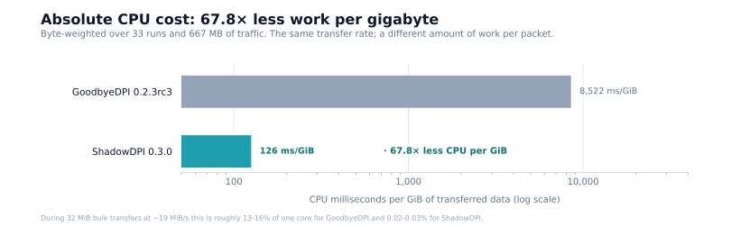
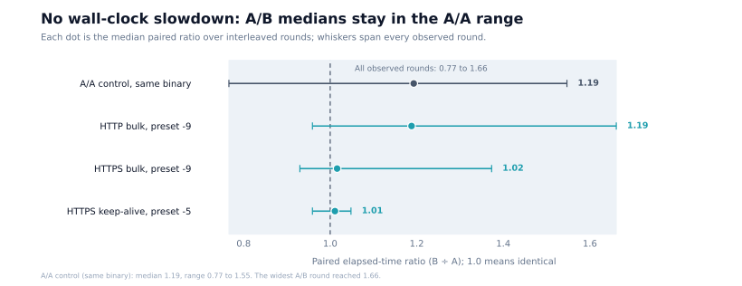
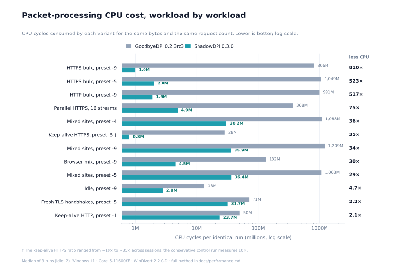

<p align="center">
  
</p>

<h1 align="center">ShadowDPI</h1>

<p align="center">
  <strong>Современная и лёгкая утилита обхода Deep Packet Inspection для Windows x64.</strong>
</p>

<p align="center">
  <a href="https://github.com/amcique/ShadowDPI/actions/workflows/build.yml"></a>
  <a href="https://github.com/amcique/ShadowDPI/releases"></a>
  <a href="https://github.com/amcique/ShadowDPI/releases"></a>
  <a href="#сборка-из-исходников-msvc-x64"></a>
  <a href="LICENSE"></a>
</p>

<p align="center">
  <a href="README.md">English</a> · <strong>Русский</strong> · <a href="README.tr.md">Türkçe</a>
</p>

ShadowDPI меняет первые пакеты соединения, чтобы оборудованию глубокой проверки
пакетов (DPI) было сложнее распознать трафик. Программа работает как обычное
приложение поверх WinDivert, не меняет существующее шифрование HTTPS и не
добавляет своего: HTTP-трафик остаётся открытым. Приложения по-прежнему
подключаются к настоящему серверу.

Поддерживаются HTTP и HTTPS; QUIC можно заблокировать, чтобы браузер перешёл на
TCP. Встроенный сканер пробует разные настройки на выбранных вами сайтах. Нужны
права администратора, потому что программа загружает драйвер ядра. Это не VPN:
IP-адрес не меняется, и трафик не идёт через другой сервер.

## Быстрый старт

1. Скачайте [последний релиз](https://github.com/amcique/ShadowDPI/releases).
   Публикуются два файла для Windows x64: MSI-установщик и переносной архив.
2. Для установки с мастером запустите `shadowdpi-<version>-x64.msi`. Он скопирует
   файлы в `%ProgramFiles%\ShadowDPI`, зарегистрирует автозапускаемую службу
   `ShadowDPI` с пресетом `-9` и запустит её. В мастере можно изменить имя службы,
   аргументы, тип запуска и нужно ли запускать службу сразу. Если уже есть старая
   установка через `install.ps1`, сначала удалите её.
3. Для переносной копии распакуйте `shadowdpi-<version>-x64.zip` в любую папку.
   Внутри есть `install.ps1`, `WinDivert.dll` и `WinDivert64.sys`. В PowerShell,
   запущенном от имени администратора, из этой папки:

   ```powershell
   .\install.ps1 -Action install
   ```

   Ключ `-Action install -NoService` копирует файлы без создания службы.

И MSI, и архив не подписаны. Способ проверки описан в [SECURITY.md](SECURITY.md).

Чтобы попробовать без установки, запустите исполняемый файл от администратора.
Без аргументов применяется `-9`; это правильная первая попытка для большинства
провайдеров:

```powershell
.\shadowdpi.exe
```

Есть также необязательный трей-интерфейс: `.\shadowdpi-gui.exe`. Он работает без
прав администратора и управляет службой через IPC. В нём есть мастер поиска
стратегии и редакторы пресетов, чёрного списка и DNS. Подробности:
[docs/gui.md](docs/gui.md).

Если провайдер подменяет ответы DNS, включите безопасный DNS в браузере или
перенаправьте DNS на уровне пакетов:

```powershell
.\shadowdpi.exe -9 --dns-addr 77.88.8.8 --dns-port 1253
```

Обновление MSI-установки: запустите новый MSI, настройки службы сохранятся. Для
обновления переносной копии распакуйте новый релиз и выполните
`.\install.ps1 -Action upgrade` из этой папки. Изменить аргументы службы или
удалить её в переносной копии можно через `-Action reconfigure` и
`-Action uninstall`. MSI-установку можно удалить в Параметрах Windows или через
`msiexec /x`. При обновлении вручную заменяйте `shadowdpi.exe`, `WinDivert.dll` и
`WinDivert64.sys` вместе, чтобы их версии совпадали.

## Почему ShadowDPI

- **Низкая нагрузка на CPU.** Около 0,03% одного ядра на
  загруженном канале 19 MiB/s. Полное сравнение с GoodbyeDPI находится в разделе
  [Производительность](#производительность).
- **Ничего не нужно отменять.** Если ShadowDPI остановить, приложения продолжат
  работать. Сертификаты не устанавливаются и настройки прокси не меняются.
- **Встроенный сканер стратегий.** DPI у каждого провайдера свой и
  меняется со временем. `install.ps1 -Action scan` проверяет пресеты и
  комбинации параметров на вашем списке URL и сообщает первую стратегию,
  которая открывает всё заблокированное и ничего не ломает.
- **C++20, тесты и бенчмарк.** Один исполняемый файл и
  поставляемый с ним драйвер WinDivert; независимое от платформы ядро с
  юнит-тестами; тонкий слой Windows; сравнение парсера с
  `WinDivertHelperParsePacket` на случайном корпусе; бенчмарк парсера с
  контролем ускорения в CI.
- **Публичный разбор кода.** Перед первым публичным релизом проведён разбор
  кода с 20 найденными проблемами, и все они исправлены. Отчёт:
  [`docs/reviews/2026-11-source-review.md`](docs/reviews/2026-11-source-review.md).

## Сравнение

| | ShadowDPI | GoodbyeDPI | Zapret | ByeDPI |
|---|---|---|---|---|
| Платформа | Windows x64 | Windows | Linux, Windows (`winws`) | Кроссплатформенный |
| Механизм | WinDivert, прозрачно | WinDivert, прозрачно | desync через netfilter / WinDivert | Локальный SOCKS5-прокси |
| Нужен администратор | Да | Да | Да | Нет |
| Настройка | Пресеты, около 40 ключей | Пресеты, ключи | Конфиги и списки хостов | Ключи и прокси-клиент |
| Встроенный сканер стратегий | Да | Нет | `blockcheck` | Нет |
| Измеренный CPU на ГиБ | **1× (база)** | 67,8× | не измерялось | не измерялось |

ShadowDPI и GoodbyeDPI сравнивались напрямую; Zapret и ByeDPI не сравнивались, и «не
измерялось» не означает превосходства. Они решают ту же задачу другими
средствами, а Zapret даёт заметно больше вариантов desync. Если пресеты
ShadowDPI не подходят вашему провайдеру, попробуйте и их. Методика и оговорки:
[docs/performance.md](docs/performance.md).

## Возможности

- **Блокирует пассивный DPI.** Внедрённые редиректы и TCP-сбросы отбрасываются
  до того, как дойдут до приложения.
- **Обходит активный DPI.** HTTP-запросы и TLS ClientHello разделяются,
  переупорядочиваются и переписываются; необязательные пакеты-обманки несут
  короткий TTL, неверную контрольную сумму или устаревший номер
  последовательности.
- **Работает с QUIC.** `-9` отбрасывает QUIC/HTTP3 Initial, чтобы браузер
  перешёл на TCP, где применимы остальные приёмы.
- **Ограничивает область работы.** Чёрный список позволяет применять приёмы,
  зависящие от имени хоста, только к выбранным доменам. Ранний шаг с размером
  окна в SYN/ACK выполняется до того, как имя хоста известно, и поэтому остаётся
  глобальным для обрабатываемых портов.
- **Перенаправляет отравленный DNS.** Адреса резолверов IPv4 и IPv6 можно
  заменять на лету, с проверкой ID транзакции, вопроса и адреса резолвера.

## Производительность

По сравнению с GoodbyeDPI v0.2.3rc3 на том же хосте, с теми же нагрузками,
тем же объёмом байтов и чередующимися циклами ShadowDPI использовал **в 67,8
раза меньше CPU на гигабайт**, а время передачи не изменилось.



Оба варианта передают данные с одинаковой скоростью, но ShadowDPI тратит
значительно меньше циклов. Это оставляет запас для роутеров, VPN и остального
программного обеспечения на машине.



Контроль A/A (один и тот же бинарник в обоих слотах) дал медианное отношение
1,193 в диапазоне от 0,766 до 1,547: на этом хосте разница в десятки процентов
нормальна. Медианы A/B для HTTP, HTTPS и keep-alive попадают в этот диапазон, а
парные отношения CPU (0,0023, 0,0011, 0,0911) в него не попадают.

### Нагрузка на CPU во всех двенадцати сценариях



Массовая передача по HTTPS показывает от 500 до 810 раз меньше CPU. Остальные
сценарии дают от 2 до 75 раз; приведённое выше значение 67,8× является
консервативной взвешенной по байтам суммой.

Полная матрица из двенадцати нагрузок, распределения задержек и оговорки:
[docs/performance.md](docs/performance.md).

## Пресеты

Каждый пресет добавляет группу параметров; более поздние аргументы перекрывают более ранние.

| Пресет | Что добавляет |
| --- | --- |
| от `-1` до `-4` | Пассивная блокировка и приёмы с HTTP Host; разделение TLS: 2, 40 или выключено |
| `-5` | Разделение HTTP/TLS, обратный порядок и автоматический fake TTL |
| `-6` | Разделение и пакеты-обманки с неверным номером последовательности |
| `-7` | Разделение и пакеты-обманки с неверной контрольной суммой |
| `-8` | И неверная последовательность, и неверная контрольная сумма |
| `-9` | `-8` плюс блокировка QUIC (по умолчанию) |

Полезные варианты:

```powershell
.\shadowdpi.exe -5                                  # если -9 слишком агрессивен
.\shadowdpi.exe -5 --blacklist C:\blocked.txt       # только для указанных доменов
.\shadowdpi.exe -9 --verbose                        # подробная диагностика
.\shadowdpi.exe --help                              # параметры этой сборки
```

`-9` намеренно блокирует QUIC. Если приложению нужен QUIC и оно не умеет
переходить на TCP, начните с `-5`.

### Поиск рабочей стратегии

Готовые пресеты служат отправной точкой, а не гарантией. Сканер стратегий проверяет
пресеты и комбинации параметров на списке URL, используя то же сравнение с
базовой линией, что и blockcheck в zapret. Сканер запускает отдельный процесс
ShadowDPI для каждого кандидата, ждёт `--ready-file`, проверяет URL через
`curl.exe` и сообщает первую стратегию, которая открывает все заблокированные
URL и не ломает работающие.

```powershell
.\install.ps1 -Action scan -ScanLevel quick
.\install.ps1 -Action scan -UrlFile .\blocked.txt -ScanLevel standard -Json result.json
.\install.ps1 -Action scan -Urls wikipedia.org,x.com -DnsAddr 77.88.8.8 -DnsPort 1253
```

Сканирование есть и в меню `install.ps1`. Отредактируйте `tools\scan-urls.txt`
или передайте `-Urls`. В интерактивном режиме сканер спросит, какой резолвер
использовать: Cloudflare, Google, другой или системный. Ключ
`-DnsResolver system` пропускает вопрос, `-DnsAddr` задаёт свой адрес и порт.
Сканеру нужны права администратора и `curl.exe`; перед базовой линией
установленная работающая служба останавливается, а затем запускается снова.
Уровни, вердикты, поля JSON и коды возврата описаны в
[docs/scan.md](docs/scan.md).

Полный справочник параметров, таблица псевдонимов, формат чёрного списка и
правила проверки: [docs/cli.md](docs/cli.md). Действия установщика, настройки
службы и `install.json`: [docs/install.md](docs/install.md).

## Под капотом

WinDivert перехватывает пакеты на уровне Windows Filtering Platform и передаёт их
в пользовательское пространство. ShadowDPI разбирает заголовки IP и TCP,
определяет, относится ли пакет к соединению, которое нужно изменить,
переписывает или разделяет пакет, пересчитывает контрольные суммы и возвращает
результат в стек. Отдельные фильтры отбрасывания обрабатывают пассивный DPI и QUIC.

Реализация разделена на независимое от WinDivert ядро и тонкий слой Windows:

- Ядро отвечает за разбор аргументов, построение фильтров, анализ HTTP/TLS,
  чёрные списки, счётчики TTL/DNS и генерацию пакетов-обманок. Ядро покрыто
  юнит-тестами без WinDivert.
- Слой Windows владеет дескрипторами WinDivert, циклом приёма пакетов,
  повторной инъекцией и жизненным циклом службы.
- Парсер пакетов проверяется побайтово по сравнению с
  `WinDivertHelperParsePacket`, в том числе на случайном корпусе.

Приёмы меняют границы пакетов, отступы в заголовках, регистр букв или TTL.
Они не меняют смысл HTTP или TLS, и трафик не расшифровывается.

## Безопасность

ShadowDPI требует права администратора, поэтому к нему предъявляются более
строгие требования, чем к обычной настольной программе.

- `shadowdpi.exe` **не** импортирует `WinDivert.dll` статически. DLL загружается
  во время выполнения с явными флагами поиска в папке приложения и System32
  через `GetProcAddress`, а путь поиска процессов ограничивается до загрузки
  других модулей. `dumpbin /DEPENDENTS` не показывает статический импорт
  WinDivert.
- Перенаправленные ответы DNS принимаются только если локальная конечная точка,
  ID транзакции, вопрос и адрес резолвера совпадают с запросом, который
  перенаправил ShadowDPI. Несовпадающие ответы отбрасываются, включая ответы на
  запросы, начатые до запуска ShadowDPI, и пакеты со сжатым именем в вопросе.
- Счётчики TTL и DNS имеют жёсткие ограничения и вытесняют записи, поэтому
  поток поддельных пакетов не может неограниченно расходовать память.
- Телеметрии и собственных исходящих подключений нет.

Предрелизный разбор, после которого внесены эти изменения, публичен:
[`docs/reviews/2026-11-source-review.md`](docs/reviews/2026-11-source-review.md).
Об уязвимостях сообщайте по [SECURITY.md](SECURITY.md), а не через публичный issue.

## Требования

- **Windows 10 или 11, x64.** Windows 7 и 8.1 могут работать, если система
  доверяет подписям драйверов SHA-2
  ([KB3033929](https://www.microsoft.com/en-us/download/details.aspx?id=46148)),
  но основной целью тестирования они не являются.
- **Права администратора.** Установщик регистрирует службу, а драйвер WinDivert
  загружается при первом запуске.
- **Самодостаточный исполняемый файл.** Используется статическая библиотека
  времени выполнения MSVC; релиз содержит подходящие DLL и драйвер WinDivert.
  Запускать `install.ps1` необязательно: скрипт только копирует файлы и
  регистрирует службу.
- **Windows PowerShell 5.1 или PowerShell 7** нужны для `install.ps1`, сканеру
  также нужен `curl.exe`. Windows PowerShell 5.1 и `curl.exe` входят в Windows 10
  и новее; PowerShell 7 нужно установить отдельно.

## Сборка из исходников (MSVC x64)

ShadowDPI является **проектом только для x64 и MSVC**. 32-битной, MinGW, Clang и ARM64
сборки нет: пресет CMake выбирает инструменты Visual Studio x64, а попытка
собрать под другую архитектуру намеренно завершается ошибкой.

Понадобятся:

- Visual Studio 2022 или новее с рабочей нагрузкой **Desktop development with C++**.
- CMake 3.25 или новее.
- Дистрибутив WinDivert 2.2.x.

Укажите `WINDIVERT_ROOT` на распакованную папку WinDivert, затем в Developer
PowerShell выполните настройку, сборку и тесты:

```powershell
$env:WINDIVERT_ROOT = "C:\path\to\WinDivert-2.2.0-D"
cmake --preset msvc-x64
cmake --build --preset msvc-x64-release
ctest --preset msvc-x64-release --output-on-failure
```

В папке должны быть `include\windivert.h` и `x64\WinDivert.lib`. Сборка копирует
`WinDivert.dll` и `WinDivert64.sys` рядом с исполняемым файлом в
`build\msvc-x64\Release\`.

Тесты и бенчмарк парсера собираются по умолчанию. Чтобы собрать только
исполняемый файл, настройте с `-DSHADOWDPI_BUILD_TESTS=OFF`. Для строгой сборки,
как в CI, добавьте `-DSHADOWDPI_WARNINGS_AS_ERRORS=ON` и
`-DSHADOWDPI_REQUIRE_WINDIVERT_RUNTIME=ON`; в CI включены оба флага.

Сообщения об ошибках и pull request приветствуются.
[CONTRIBUTING.md](CONTRIBUTING.md) описывает процесс проверки, формат коммитов
и правила оформления.

### Что покрывают тесты

- `core`: CLI, конфигурация, фильтры, вспомогательные функции HTTP/TLS, чёрный
  список и счётчики без WinDivert.
- `windows`: фильтры, скомпилированные WinDivert, сравнение парсера с
  `WinDivertHelperParsePacket`, сравнение после перебазирования и эталонные
  случаи механизма пакетов: переписывание, фрагментация, обманки, DNS redirect
  и пассивный DPI.
- `benchmark`: пропускная способность парсера по сравнению с помощником
  WinDivert, с минимальным ускорением в оптимизированных сборках.

## Служба Windows

Установщик по умолчанию регистрирует автоматически запускаемую службу `ShadowDPI`:

```powershell
.\install.ps1 -Action install
```

Имя службы, аргументы и тип запуска меняются так:

```powershell
.\install.ps1 -Action reconfigure -ServiceArgs '-5'
```

Исполняемый файл регистрируется как служба при запуске диспетчером служб и
корректно завершается по запросу остановки. Если управлять службой вручную,
эквивалентные команды:

```powershell
New-Service -Name ShadowDPI `
  -BinaryPathName '"C:\Tools\ShadowDPI\shadowdpi.exe" -9' `
  -DisplayName ShadowDPI -StartupType Automatic
sc.exe description ShadowDPI "Deep Packet Inspection circumvention utility"
Start-Service ShadowDPI
```

Удалить установку вместе со службой:

```powershell
.\install.ps1 -Action uninstall
```

Полная справка по установщику: [docs/install.md](docs/install.md).

## Ограничения

- **Универсального пресета нет.** Поведение DPI зависит от провайдера и
  меняется со временем. `-9` служит отправной точкой, а не гарантией. Если пресеты не
  работают, запустите [сканер стратегий](docs/scan.md) на своём списке URL.
- **Перенаправление DNS работает по принципу «отказ закрытием».** Трекер должен
  видеть запрос, чтобы восстановить ответ. Ответы на запросы, начатые до запуска
  ShadowDPI, а также те, чья запись истекла или была вытеснена при нагрузке,
  отбрасываются.
- **IPv6 реализован, но не проверен в полевых условиях.** На тестовом хосте не
  было живого пути IPv6 с DPI, поэтому обход IPv6 на реальном провайдере не
  проверялся.
- **Блокировка QUIC меняет поведение.** `-9` намеренно заставляет переходить на
  TCP.
- **Старые образы Windows 7** могут отвергнуть драйвер WinDivert без поддержки
  SHA-2.
- **Сетевые карты Killer/Intel:** отключите *Advanced Stream Detect* в Killer
  Control Center, если ShadowDPI не запускается или зависает.
- **Цифры бенчмарка зависят от хоста.** Относительное преимущество по CPU
  устойчиво, абсолютные значения для вашего канала не гарантируются.
- **Только Windows x64.** Сборок для ARM64, 32-бит, Linux и macOS нет.

## Частые вопросы

**Windows предупреждает «Windows защитила ваш компьютер», и антивирус жалуется.**
Это ожидаемо: исполняемый файл релиза не подписан Authenticode и устанавливает
драйвер ядра, именно такой профиль не нравится системам репутации. Проверяйте
загрузку, а не доверяйте окну: сравните SHA-256 с опубликованным файлом `.sha256`
и проверьте аттестацию сборки (см. ниже) или
[соберите из исходников](#сборка-из-исходников-msvc-x64). Сам WinDivert является
долгоживущим легитимно подписанным драйвером.

**Является ли ShadowDPI VPN? Скрывает ли он мой IP?**
Нет. ShadowDPI меняет вид пакетов на проводе, чтобы DPI было сложнее их
классифицировать. Трафик по-прежнему идёт напрямую к настоящему серверу с вашего
реального адреса. Шифрование не добавляется и не удаляется.

**Расшифровывает ли ShadowDPI мой трафик?**
Нет. Инструмент не перехватывает TLS, не устанавливает сертификаты и не работает
как прокси. Изменяются только границы пакетов, отступы в заголовках, регистр,
TTL и поля порядкового номера или контрольной суммы.

**С какого пресета начать?**
`-9`. Если что-то ломается, попробуйте `-5`. Если ни один не помогает, запустите
сканер стратегий.

**Повлияет ли блокировка QUIC на Discord, игры и другие приложения?**
`-9` блокирует QUIC, чтобы браузеры перешли на TCP. Если приложению нужен QUIC
и оно не может перейти на TCP, используйте `-5` или добавьте нужные хосты в
чёрный список.

**Почему у других работает, а у меня нет?**
Поведение DPI зависит от провайдера и меняется со временем. Универсального
пресета нет: запустите сканер на своём списке URL и откройте issue с результатом.

## Проверка загрузки

Каждый релиз публикует MSI, zip и файл `.sha256` к ним:

```powershell
Get-FileHash .\shadowdpi-0.5.0-x64.msi -Algorithm SHA256
Get-FileHash .\shadowdpi-0.5.0-x64.zip -Algorithm SHA256
Get-Content .\shadowdpi-0.5.0-x64.sha256
```

Оба файла покрыты аттестацией происхождения сборки GitHub, которая фиксирует
workflow, коммит и runner, создавшие их:

```powershell
gh attestation verify .\shadowdpi-0.5.0-x64.msi --repo amcique/ShadowDPI
gh attestation verify .\shadowdpi-0.5.0-x64.zip --repo amcique/ShadowDPI
```

Если проверка не проходит, не запускайте установщик или бинарник.

Исполняемый файл не подписан сертификатом Authenticode, поэтому Windows может
показывать «Windows protected your PC», а антивирусы могут предупреждать: это
ожидаемо для неподписанного файла, устанавливающего драйвер ядра. Проверяйте
хеш и аттестацию либо собирайте из исходников.

## Назначение

ShadowDPI предназначен для исследования сетей, доступа к информации, на
которую у вас есть право, и изучения поведения оборудования DPI. Это не
инструмент для атак на сети. Законы и сетевые политики различаются по странам и
организациям: ответственность за законное использование лежит на вас, и этот
текст не является юридической консультацией.

## Благодарности

Идею изменения сегментации TCP и заголовков в пользовательском пространстве
для обхода DPI на Windows популяризировал **ValdikSS** и проект
[GoodbyeDPI](https://github.com/ValdikSS/GoodbyeDPI). ShadowDPI следует этой
концепции как независимая реализация на C++20 и не содержит кода или ресурсов
GoodbyeDPI.

Перехват пакетов обеспечивает **WinDivert** от
[basil00](https://github.com/basil00/Divert). Это значительная часть того, что
сделало проект возможным. Сведения о лицензии в [NOTICE](NOTICE).

## Лицензия

ShadowDPI распространяется под
[GNU General Public License, version 3](LICENSE). Полные исходники каждого
релиза находятся в соответствующем теге этого репозитория. WinDivert распространяется без
изменений под LGPLv3; подробности в [NOTICE](NOTICE) и
[third_party/WinDivert/LICENSE](third_party/WinDivert/LICENSE).

---

*Другие языки: [English](README.md) · [Türkçe](README.tr.md).*
