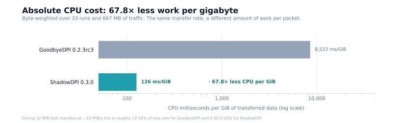
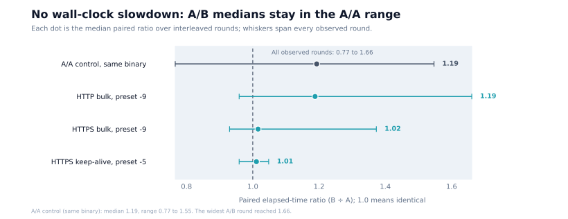
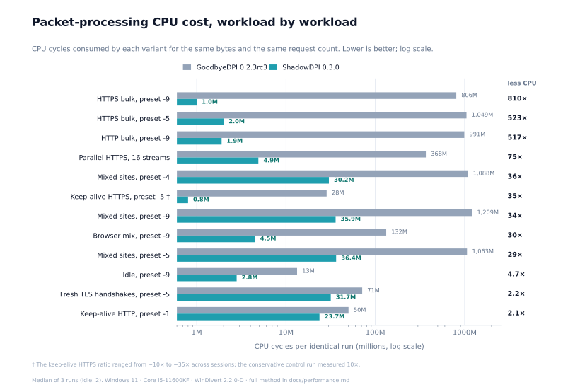

<p align="center">
  
</p>

<h1 align="center">ShadowDPI</h1>

<p align="center">
  <strong>Windows x64 için modern ve hafif DPI atlatma aracı.</strong>
</p>

<p align="center">
  <a href="https://github.com/amcique/ShadowDPI/actions/workflows/build.yml"></a>
  <a href="https://github.com/amcique/ShadowDPI/releases"></a>
  <a href="https://github.com/amcique/ShadowDPI/releases"></a>
  <a href="#kaynaktan-derleme-msvc-x64"></a>
  <a href="LICENSE"></a>
</p>

<p align="center">
  <a href="README.md">English</a> · <a href="README.ru.md">Русский</a> · <strong>Türkçe</strong>
</p>

ShadowDPI, bir bağlantının ilk paketlerini değiştirerek derin paket incelemesinin
(DPI) bağlantıyı tanımasını zorlaştırır. WinDivert üzerinde normal bir program
olarak çalışır; mevcut HTTPS şifrelemesini değiştirmez. Şifreleme eklenmez.
HTTP trafiği düz metin kalır. Uygulamalar gerçek sunucuya bağlanmaya devam eder.

HTTP ve HTTPS ile çalışır; QUIC engellenerek tarayıcının TCP'ye geçmesi
sağlanabilir. Yerleşik strateji tarayıcısı, seçtiğiniz sitelerde farklı ayarları
dener. Yönetici hakları gerekir, çünkü bir çekirdek sürücüsü yüklenir. Bu bir VPN
değildir: IP adresiniz değişmez ve trafiğiniz başka bir sunucudan geçmez.

## Hızlı başlangıç

1. [Son sürümü](https://github.com/amcique/ShadowDPI/releases) indirin.
2. Arşivi herhangi bir klasöre çıkarın. Pakette `install.ps1`, `WinDivert.dll` ve
   `WinDivert64.sys` birlikte gelir.
3. Yönetici olarak açtığınız PowerShell'de, arşivi çıkardığınız klasörden:

   ```powershell
   .\install.ps1 -Action install
   ```

Bu komut, dosyaları `%ProgramFiles%\ShadowDPI` klasörüne kopyalar, `-9` ile
otomatik başlayan `ShadowDPI` hizmetini kaydeder ve başlatır. `-Action install
-NoService` yalnızca dosyaları kopyalar, hizmet oluşturmaz.

Kurmadan denemek için çalıştırılabilir dosyayı yönetici olarak başlatın.
Bağımsız değişken verilmezse `-9` uygulanır; çoğu sağlayıcı için doğru ilk deneme
budur:

```powershell
.\shadowdpi.exe
```

Sağlayıcı DNS yanıtlarını zehirliyorsa tarayıcıda güvenli DNS'i açın veya DNS'i
paket düzeyinde yönlendirin:

```powershell
.\shadowdpi.exe -9 --dns-addr 77.88.8.8 --dns-port 1253
```

Yükseltmek için yeni sürümü çıkarın ve o klasörde `.\install.ps1 -Action
upgrade` çalıştırın; mevcut hizmet ayarları korunur. Hizmet bağımsız
değişkenlerini değiştirmek veya hizmeti kaldırmak için `-Action reconfigure` ve
`-Action uninstall` kullanın. Elle güncellerken `shadowdpi.exe`,
`WinDivert.dll` ve `WinDivert64.sys` dosyalarını birlikte değiştirin, böylece
sürümleri uyumlu kalsın.

## Neden ShadowDPI

- **Düşük CPU maliyeti.** 19 MiB/s hızındaki yoğun bir bağlantıda
  tek çekirdeğin yaklaşık %0,03'ü. GoodbyeDPI ile tam karşılaştırma
  [Performans](#performans) bölümünde.
- **Geri alınacak bir şey yok.** ShadowDPI durursa uygulamalar çalışmaya devam
  eder. Sertifika kurulmaz ve proxy ayarları değiştirilmez.
- **Yerleşik strateji tarayıcısı.** DPI sağlayıcıya
  göre değişir ve zamanla güncellenir. `install.ps1 -Action scan` hazır ayarları
  ve seçenek birleşimlerini kendi URL listenizde dener, engellenen her adresi
  açan ve çalışan hiçbir adresi bozmayan ilk stratejiyi bildirir.
- **C++20, testler ve ölçüm.** Tek bir çalıştırılabilir dosya
  ve paketle gelen WinDivert sürücüsü; platformdan bağımsız ve birim testleri olan
  bir çekirdek; ince bir Windows katmanı; `WinDivertHelperParsePacket` ile
  karşılaştırmalı testler ve rastgele bir korpusla sınanan bir paket ayrıştırıcı;
  CI'da hız eşiği denetlenen bir ayrıştırıcı ölçümü.
- **Herkese açık kod incelemesi.** İlk herkese açık sürümden önce 20 bulgu
  içeren bir kaynak incelemesi yapıldı ve hepsi düzeltildi. Rapor:
  [`docs/reviews/2026-11-source-review.md`](docs/reviews/2026-11-source-review.md).

## Karşılaştırma

| | ShadowDPI | GoodbyeDPI | Zapret | ByeDPI |
|---|---|---|---|---|
| Platform | Windows x64 | Windows | Linux, Windows (`winws`) | Platformdan bağımsız |
| Yöntem | WinDivert, şeffaf | WinDivert, şeffaf | netfilter / WinDivert desync | Yerel SOCKS5 proxy |
| Yönetici gerekir | Evet | Evet | Evet | Hayır |
| Yapılandırma | Hazır ayarlar, yaklaşık 40 anahtar | Hazır ayarlar, anahtarlar | Yapılandırma dosyaları ve host listeleri | Anahtarlar ve proxy istemcisi |
| Yerleşik strateji tarayıcısı | Evet | Hayır | `blockcheck` | Hayır |
| Ölçülen GiB başına CPU | **1× (temel)** | 67,8× | ölçülmedi | ölçülmedi |

ShadowDPI ile GoodbyeDPI doğrudan karşılaştırıldı; Zapret ve ByeDPI
karşılaştırılmadı ve "ölçülmedi" bir üstünlük iddiası değildir. Aynı sorunu
farklı ödünleşmelerle çözerler ve Zapret, ShadowDPI'den çok daha fazla desync
seçeneği sunar. Hazır ayarlar sağlayıcınıza uymuyorsa onları da deneyin. Yöntem
ve uyarılar: [docs/performance.md](docs/performance.md).

## Özellikler

- **Pasif DPI'yi engeller.** Enjekte edilen yönlendirmeler ve TCP sıfırlamaları
  uygulamaya ulaşmadan düşürülür.
- **Aktif DPI'yi atlatır.** HTTP istekleri ve TLS ClientHello paketleri bölünür,
  yeniden sıralanır ve yeniden yazılır; isteğe bağlı sahte paketler kısa bir TTL,
  hatalı bir sağlama toplamı veya eski bir sıra numarası taşır.
- **QUIC ile baş eder.** `-9`, QUIC/HTTP3 Initial paketlerini düşürür ve
  tarayıcının TCP'ye dönmesini sağlar; diğer teknikler orada uygulanır.
- **Kapsamı daraltır.** Kara liste, host adına bakan tekniklerin yalnızca seçilen
  alan adlarında uygulanmasını sağlar. SYN/ACK penceresi adımı host adı
  bilinmeden çalıştığı için işlenen portlarda genel kalmak zorundadır.
- **Zehirlenmiş DNS'i yönlendirir.** IPv4 ve IPv6 çözümleyici adresleri uçuşta
  değiştirilebilir; işlem kimliği, soru ve çözümleyici adresi doğrulanır.

## Performans

Aynı makinede, aynı iş yükleri, aynı bayt sayıları ve sırayla değişen turlarla
GoodbyeDPI v0.2.3rc3 ile karşılaştırıldığında ShadowDPI **gigabayt başına 67,8
kat daha az CPU** kullandı ve aktarım süresi değişmedi.



Her iki sürüm de veriyi aynı hızda taşıyor. ShadowDPI bunu çok daha az çevrimle
yapıyor, bu da makineyi paylaşan yönlendiricilere, VPN'lere ve diğer
yazılımlara alan bırakıyor.



A/A kontrolü aynı ikiliyi iki yuvada çalıştırır. Medyan oran 1,193, aralık 0,766
ile 1,547 arasındaydı; yani bu makinede yüzde onlarca fark normaldir. HTTP, HTTPS
ve keep-alive için A/B medyanlarının tamamı bu aralığa düşer; eşleştirilmiş CPU
oranları (0,0023, 0,0011, 0,0911) ise bu aralığa girmez.



### Tüm on iki iş yükünde CPU maliyeti

Toplu HTTPS aktarımları 500-810 kat daha az CPU kullanır. Diğer iş yükleri
2-75 kat fark gösterir; yukarıdaki 67,8× değeri bayt ağırlıklı temkinli toplamdır.

On iki iş yükünün tamamı, gecikme dağılımları ve uyarılar:
[docs/performance.md](docs/performance.md).

## Hazır ayarlar

Hazır ayarlar birbirine eklenen seçenek gruplarıdır; sonraki bağımsız
değişkenler öncekileri geçersiz kılar.

| Hazır ayar | Ne ekler |
| --- | --- |
| `-1` ile `-4` arası | Pasif engelleme ve HTTP Host teknikleri; TLS bölme 2, 40 veya kapalı |
| `-5` | HTTP/TLS bölme, ters sıra ve otomatik sahte TTL |
| `-6` | Bölme ve yanlış TCP sıra numarası taşıyan sahte paketler |
| `-7` | Bölme ve hatalı sağlama toplamı taşıyan sahte paketler |
| `-8` | Hem yanlış sıra numarası hem hatalı sağlama toplamı |
| `-9` | `-8` artı QUIC engelleme (varsayılan) |

Kullanışlı varyasyonlar:

```powershell
.\shadowdpi.exe -5                                  # -9 çok agresifse
.\shadowdpi.exe -5 --blacklist C:\blocked.txt       # yalnızca listedeki alan adları
.\shadowdpi.exe -9 --verbose                        # ayrıntılı günlük
.\shadowdpi.exe --help                              # bu derlemenin seçenekleri
```

`-9` QUIC'i bilinçli olarak engeller. Bir uygulama QUIC'e ihtiyaç duyuyor ve
TCP'ye dönemiyorsa `-5` ile başlayın.

### Çalışan stratejiyi bulma

Hazır ayarlar bir başlangıç noktasıdır, garanti değildir. Strateji tarayıcısı
hazır ayarları ve seçenek birleşimlerini bir URL listesi üzerinde dener; zapret'in
blockcheck aracıyla aynı temel karşılaştırmayı kullanır. Tarayıcı, her aday
için ayrı bir ShadowDPI süreci başlatır, `--ready-file` dosyasını bekler, URL'leri
`curl.exe` ile yoklar ve engellenen her adresi açan, çalışan bir adresi
bozmayan ilk stratejiyi bildirir.

```powershell
.\install.ps1 -Action scan -ScanLevel quick
.\install.ps1 -Action scan -UrlFile .\blocked.txt -ScanLevel standard -Json result.json
.\install.ps1 -Action scan -Urls wikipedia.org,x.com -DnsAddr 77.88.8.8 -DnsPort 1253
```

Tarama `install.ps1` menüsünde de bulunur. `tools\scan-urls.txt` dosyasını
düzenleyin veya `-Urls` ile kendi listenizi verin. Etkileşimli oturumda tarayıcı
hangi DNS çözümleyicisinin kullanılacağını sorar: Cloudflare, Google, başka bir
çözümleyici veya sistem çözümleyicisi. `-DnsResolver system` sorusunu atlar,
`-DnsAddr` ise özel adres ve port verir. Tarayıcı yönetici haklarına ve
`curl.exe` dosyasına ihtiyaç duyar; temel ölçüm için kurulu ve çalışan
hizmet durdurulur ve ardından yeniden başlatılır. Tarama düzeyleri, sonuç değerlendirmeleri,
JSON alanları ve çıkış kodları [docs/scan.md](docs/scan.md) dosyasında.

Seçeneklerin tam başvurusu, takma ad tablosu, kara liste biçimi ve doğrulama
kuralları [docs/cli.md](docs/cli.md) dosyasında. Kurulum eylemleri, hizmet
ayarları ve `install.json` için [docs/install.md](docs/install.md).

## Perde arkası

WinDivert, Windows Filtering Platform katmanında paketleri yakalar ve bunları
kullanıcı alanına aktarır. ShadowDPI IP ve TCP başlıklarını ayrıştırır, paketin
dokunulması gereken bir bağlantıya ait olup olmadığına karar verir, paketi
yeniden yazar veya böler, sağlama toplamlarını hesaplar ve tekrar stack'e
verir. Pasif DPI ve QUIC için ayrı düşürme filtreleri vardır.

Uygulama, WinDivert'tan bağımsız bir çekirdek ile ince bir Windows katmanına
ayrılmıştır:

- Çekirdek; argüman ayrıştırma, filtre oluşturma, HTTP/TLS incelemesi, kara
  listeler, TTL/DNS sayaçları ve sahte yük üretiminden sorumludur. WinDivert
  olmadan birim testleri vardır.
- Windows katmanı WinDivert tanıtıcılarını, paket döngüsünü, yeniden enjeksiyonu
  ve hizmet yaşam döngüsünü yönetir.
- Paket ayrıştırıcısı `WinDivertHelperParsePacket` ile bayt bayt karşılaştırılır;
  rastgele bir korpus da kullanılır.

Bu teknikler paket sınırlarını, başlık boşluklarını, harf durumunu veya TTL'yi
değiştirir. HTTP veya TLS'in anlamını değiştirmez ve hiçbir trafik
şifrelenmez.

## Güvenlik

ShadowDPI yönetici hakları gerektirdiği için normal bir masaüstü aracından
daha yüksek bir ölçüte tabidir.

- `shadowdpi.exe`, `WinDivert.dll` dosyasını **statik olarak içe aktarmaz**. DLL
  çalışma zamanında, uygulama klasörü ve System32 için açık arama bayrakları ve
  `GetProcAddress` ile yüklenir; işlem arama yolu diğer modüller yüklenmeden
  önce kısıtlanır. `dumpbin /DEPENDENTS` statik WinDivert içe aktarması
  göstermez.
- Yönlendirilen DNS yanıtları yalnızca yerel uç nokta, işlem kimliği, soru ve
  çözümleyici adresi ShadowDPI'ın ilettiği bir sorguyla eşleşirse kabul edilir.
  Eşleşmeyen yanıtlar, ShadowDPI başlamadan önce başlatılan sorguların
  yanıtları ve sıkıştırılmış soru içeren paketler de dahil olmak üzere
  düşürülür.
- TTL ve DNS sayaçlarının katı giriş sınırları vardır ve eski girişleri atar;
  böylece sahte paket seli belleği sınırsız büyütemez.
- Telemetri yoktur ve aracın kendi kendine açtığı bir giden bağlantı yoktur.

Bu değişikliklerin yapıldığı sürüm öncesi inceleme herkese açıktır:
[`docs/reviews/2026-11-source-review.md`](docs/reviews/2026-11-source-review.md).
Güvenlik açıklarını genel bir issue yerine [SECURITY.md](SECURITY.md) üzerinden
bildirin.

## Gereksinimler

- **Windows 10 veya 11, x64.** Windows 7 ve 8.1, sistem SHA-2 sürücü imzalarına
  güveniyorsa çalışabilir
  ([KB3033929](https://www.microsoft.com/en-us/download/details.aspx?id=46148)),
  ancak birincil test hedefi değildir.
- **Yönetici hakları.** Kurulum bir hizmet kaydeder ve WinDivert sürücüsü ilk
  çalıştırmada yüklenir.
- **Kendi kendine yeten çalıştırılabilir dosya.** Statik MSVC çalışma zamanı
  kullanılır; sürüm paketi uyumlu WinDivert DLL ve sürücüsünü içerir.
  `install.ps1` çalıştırmak zorunlu değildir, yalnızca dosyaları kopyalar ve
  hizmeti kaydeder.
- **PowerShell 5.1** `install.ps1` için gereklidir. Strateji tarayıcısı ayrıca
  `curl.exe` ister. İkisi de Windows 10 ve sonrasında gelir.

## Kaynaktan derleme (MSVC x64)

ShadowDPI **yalnızca x64 ve MSVC** bir projedir. 32 bit, MinGW, Clang ve ARM64
derlemesi yoktur; CMake preset'i Visual Studio x64 araçlarını seçer ve başka
bir mimari için yapılandırma bilinçli olarak başarısız olur.

Gerekenler:

- **Desktop development with C++** iş yüküyle Visual Studio 2022 veya üzeri.
- CMake 3.25 veya üzeri.
- WinDivert 2.2.x dağıtımı.

`WINDIVERT_ROOT` değişkenini açılmış WinDivert klasörüne yöneltin, ardından bir
Developer PowerShell'de yapılandırın, derleyin ve test edin:

```powershell
$env:WINDIVERT_ROOT = "C:\path\to\WinDivert-2.2.0-D"
cmake --preset msvc-x64
cmake --build --preset msvc-x64-release
ctest --preset msvc-x64-release --output-on-failure
```

Klasörde `include\windivert.h` ve `x64\WinDivert.lib` bulunmalıdır. Derleme,
`WinDivert.dll` ve `WinDivert64.sys` dosyalarını çalıştırılabilir dosyanın
yanına, `build\msvc-x64\Release\` içine kopyalar.

Testler ve ayrıştırıcı ölçümü varsayılan olarak derlenir. Yalnızca çalıştırılabilir
dosyayı derlemek için `-DSHADOWDPI_BUILD_TESTS=OFF` ile yapılandırın. CI ile aynı
katı derleme için `-DSHADOWDPI_WARNINGS_AS_ERRORS=ON` ve
`-DSHADOWDPI_REQUIRE_WINDIVERT_RUNTIME=ON` ekleyin; CI'da ikisi de açıktır.

Hata bildirimleri ve pull request'ler memnuniyetle karşılanır.
[CONTRIBUTING.md](CONTRIBUTING.md) inceleme sürecini, commit biçimini ve stil
kurallarını anlatır.

### Testler neleri kapsıyor

- `core`: CLI, yapılandırma, filtreler, HTTP/TLS yardımcıları, kara liste ve
  sayaçlar, WinDivert olmadan.
- `windows`: WinDivert ile derlenen filtreler, `WinDivertHelperParsePacket` ile
  ayrıştırıcı karşılaştırması, yeniden temelleme karşılaştırması ve yeniden
  yazma, parçalama, sahte paketler, DNS yönlendirme ve pasif DPI için altın
  paket motoru durumları.
- `benchmark`: WinDivert yardımcısına göre ayrıştırıcı verimi; optimize
  derlemelerde hız eşiği uygulanır.

## Windows hizmeti

Kurulum varsayılan olarak otomatik başlayan `ShadowDPI` hizmetini kaydeder:

```powershell
.\install.ps1 -Action install
```

Hizmet adını, bağımsız değişkenleri veya başlangıç türünü değiştirmek için:

```powershell
.\install.ps1 -Action reconfigure -ServiceArgs '-5'
```

Çalıştırılabilir dosya, Hizmet Denetim Yöneticisi tarafından başlatıldığında
kendini hizmet olarak kaydeder ve durdurma isteğinde temiz bir şekilde kapanır.
Hizmeti elle yönetiyorsanız eşdeğer komutlar:

```powershell
New-Service -Name ShadowDPI `
  -BinaryPathName '"C:\Tools\ShadowDPI\shadowdpi.exe" -9' `
  -DisplayName ShadowDPI -StartupType Automatic
sc.exe description ShadowDPI "Deep Packet Inspection circumvention utility"
Start-Service ShadowDPI
```

Kurulumu hizmetle birlikte kaldırmak için:

```powershell
.\install.ps1 -Action uninstall
```

Kurulum aracının tam başvurusu [docs/install.md](docs/install.md) dosyasında.

## Sınırlamalar

- **Evrensel bir hazır ayar yok.** DPI davranışı sağlayıcıya göre değişir ve
  zamanla güncellenir. `-9` bir başlangıç noktasıdır, garanti değildir. Hazır
  ayarlar çalışmıyorsa kendi URL listenizde
  [strateji tarayıcısını](docs/scan.md) çalıştırın.
- **DNS yönlendirme «fail-closed» çalışır.** Yanıtı geri yüklemek için sorguyu
  görmesi gerekir. ShadowDPI başlamadan önce başlatılan sorguların yanıtları veya
  kaydı süresi dolmuş / yük altında atılmış yanıtlar düşürülür.
- **IPv6 uygulandı ama sahada doğrulanmadı.** Ölçüm makinesinde canlı bir IPv6 DPI
  yolu yoktu, bu yüzden IPv6 atlatma gerçek bir sağlayıcıda sınanmadı.
- **QUIC engelleme davranışı değiştirir.** `-9` bilinçli olarak TCP'ye dönmeye
  zorlar.
- **Eski Windows 7 imajları** SHA-2 desteği kurulu değilse WinDivert sürücüsünü
  reddedebilir.
- **Killer/Intel ağ kartları:** ShadowDPI başlamıyor veya takılıyorsa Killer
  Control Center içinde *Advanced Stream Detect* seçeneğini kapatın.
- **Ölçüm sayıları makineye bağlıdır.** Göreli CPU avantajı sağlamdır, mutlak
  hızlar sizin bağlantınız için bir vaat değildir.
- **Yalnızca Windows x64.** ARM64, 32 bit, Linux ve macOS derlemesi yoktur.

## Sık sorulan sorular

**Windows "Windows protected your PC" diyor ve antivirüsüm uyarı veriyor.**
Beklenen bir durum: sürüm dosyası Authenticode ile imzalanmamıştır ve kurulum
bir çekirdek sürücüsü yükler; itibar sistemlerinin hoşlanmadığı profil
tam olarak bu. İstemeye güvenmek yerine indirmeyi doğrulayın: SHA-256 değerini
yayımlanan `.sha256` dosyasıyla karşılaştırın, derleme kanıtını kontrol edin
(aşağıya bakın) veya [kaynaktan derleyin](#kaynaktan-derleme-msvc-x64).
WinDivert'ın kendisi uzun süredir geçerli şekilde imzalanmış bir sürücüdür.

**ShadowDPI bir VPN mi? IP adresimi gizliyor mu?**
Hayır. ShadowDPI paketlerin teller üzerinde nasıl göründüğünü değiştirir, böylece
DPI onları sınıflandırmakta zorlanır. Trafiğiniz gerçek sunucuya gerçek
adresinizden doğrudan gider. Şifreleme eklenmez veya kaldırılmaz.

**ShadowDPI trafiğimi şifreliyor mu?**
Hayır. Araç TLS'i engellemez, sertifika kurmaz ve proxy olarak çalışmaz. Yalnızca
paket sınırları, başlık boşlukları, harf durumu, TTL ve sıra numarası veya
sağlama toplamı alanları değiştirilir.

**Hangi preset ile başlamalıyım?**
`-9`. Bir şey bozulursa `-5` deneyin. İkisi de işe yaramazsa strateji
tarayıcısını çalıştırın.

**QUIC engelleme Discord, oyunlar veya diğer uygulamaları etkiler mi?**
`-9`, tarayıcıların TCP'ye geçmesi için QUIC'i engeller. Bir uygulamanın QUIC'e
ihtiyacı varsa ve TCP'ye geçemiyorsa `-5` kullanın veya ilgili sunucuları kara
listeye ekleyin.

**ShadowDPI başkalarında çalışıp bende neden çalışmıyor?**
DPI sağlayıcıya özgüdür ve zamanla değişir. Evrensel bir preset yoktur; kendi
URL listenizle tarayıcıyı çalıştırın ve çıktısıyla bir issue açın.

## İndirmeyi doğrulama

Her sürüm `shadowdpi-<sürüm>-x64.zip` dosyasını ve eşleşen `.sha256` dosyasını
yayımlar:

```powershell
Get-FileHash .\shadowdpi-0.4.0-x64.zip -Algorithm SHA256
Get-Content .\shadowdpi-0.4.0-x64.sha256 | Select-String 'shadowdpi-0.4.0-x64.zip'
```

Arşiv ayrıca GitHub derleme kaynağı kanıtı ile imzalanır; bu kayıt arşivi hangi
iş akışının, hangi commit'in ve hangi çalıştırıcının ürettiğini gösterir:

```powershell
gh attestation verify .\shadowdpi-0.4.0-x64.zip --repo amcique/ShadowDPI
```

İki denetimden biri başarısız olursa ikiliyi çalıştırmayın.

Çalıştırılabilir dosya Authenticode ile imzalanmadığı için Windows "Windows
protected your PC" uyarısı gösterebilir ve bazı antivirüsler uyarabilir: çekirdek
sürücü kuran imzasız bir dosya için bu beklenen bir durumdur. Karmayı ve
kanıtı doğrulayın veya kaynaktan derleyin.

## Amaçlanan kullanım

ShadowDPI ağ araştırması, hakkınız olan bilgilere erişim ve DPI cihazlarının
nasıl davrandığını anlama amacıyla geliştirildi. Ağlara saldırmak için bir araç
değildir. Yasalar ve ağ politikaları ülkeye ve kuruma göre değişir; aracı yasal
ve kurallara uygun biçimde kullanmak sizin sorumluluğunuzdadır ve bu metin
hukuki danışmanlık değildir.

## Teşekkürler

TCP segmentasyonunu ve başlıklarını kullanıcı alanında değiştirerek Windows'ta
DPI'ı atlatma fikrini **ValdikSS** ve
[GoodbyeDPI](https://github.com/ValdikSS/GoodbyeDPI) projesi yaygınlaştırdı.
ShadowDPI bu kavramı bağımsız bir C++20 uygulaması olarak izler ve GoodbyeDPI
kodu veya varlıkları içermez.

Paket yakalama, [basil00](https://github.com/basil00/Divert) tarafından
geliştirilen **WinDivert** ile sağlanır; projenin mümkün olmasında büyük payı
vardır. Lisans bilgileri [NOTICE](NOTICE) dosyasındadır.

## Lisans

ShadowDPI, [GNU General Public License, version 3](LICENSE) altında
yayımlanmıştır. Her sürümün tam kaynak kodu bu depodaki eşleşen etikettir.
WinDivert değiştirilmeden LGPLv3 altında dağıtılır; ayrıntılar [NOTICE](NOTICE)
ve [third_party/WinDivert/LICENSE](third_party/WinDivert/LICENSE) dosyalarında.

---

*Diğer diller: [English](README.md) · [Русский](README.ru.md).*
