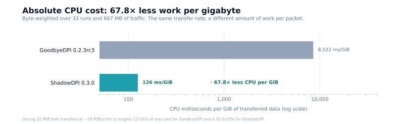
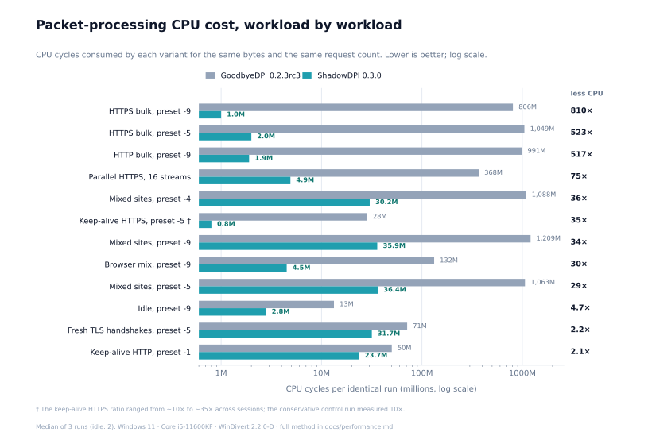
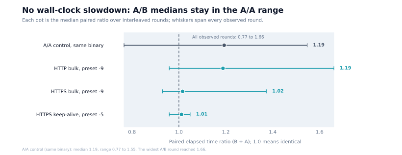

# Performance

ShadowDPI is not a faster pipe. It moves the same bytes at the same wall-clock
speed as GoodbyeDPI and does far less CPU work to get them there.

That distinction matters: the win is **headroom**, not throughput. On the test
host, ShadowDPI used about **1/68th of the CPU per gigabyte** of the original
binary, while paired transfer times stayed inside the host's own A/A noise
band.

## Method

Two binaries were compared against the same workloads, on the same host, over
the same network path, in interleaved rounds:

- **A:** GoodbyeDPI v0.2.3rc3, x86_64 build.
- **B:** ShadowDPI 0.3.0, MSVC x64 Release, static CRT.
- Both used the same preset and the same client script.
- Each round transferred an identical byte count and made an identical number
  of requests.
- Rounds alternated A/B/A/B so that host drift affected both variants.
- CPU was read with `QueryProcessCycleTime`, which resolves work far below the
  15.6 ms scheduler tick.
- Transfer time and per-request latency were captured by the client.
- Runs that failed were counted; every scenario below completed with zero
  failures.

The A/A control ran the **same original binary in both slots**. It measures how
much the host naturally varies between two identical rounds, and therefore how
large a difference has to be before it means anything.

GoodbyeDPI was installed separately for this comparison and is not distributed
with ShadowDPI.

## Environment

| Item | Value |
| --- | --- |
| OS | Windows 11 Pro, build 26300, x64 |
| CPU | Intel Core i5-11600KF, 6 cores / 12 threads, 3.9 GHz |
| RAM | 31.8 GiB |
| Packet layer | WinDivert 2.2.0-D |
| Client | curl 8.22.0 |
| Measured | 2026-11-14 |

This is a single-host, single-path measurement. It characterizes the software
overhead, not the success rate of any particular ISP's DPI.

## Workloads

| Workload | What it does |
| --- | --- |
| HTTP bulk | Repeated 32 MiB HTTP downloads. |
| HTTPS bulk | Repeated 32 MiB HTTPS downloads. |
| 16 parallel HTTPS | Sixteen concurrent HTTPS downloads. |
| Mixed sites | Many small pages plus bulk transfer across several sites (132 requests per variant). |
| Browser mix | A browser-like request sequence with mixed sizes and origins (36 requests per variant). |
| Fresh TLS handshakes | Forty new TLS connections per run. |
| Keep-alive HTTPS | One hundred HTTPS requests over persistent connections per run. |
| Keep-alive HTTP | One hundred HTTP requests over persistent connections per run. |
| Idle | Thirty seconds with filters open and no traffic. |

## Results

### CPU cost by workload

Median values from three interleaved runs per variant (two for idle). The
ratios are cycle counts, not estimates from the task-manager clock.

| Workload | Preset | GoodbyeDPI (M cycles) | ShadowDPI (M cycles) | Ratio | Elapsed Δ |
| --- | --- | ---: | ---: | ---: | ---: |
| HTTPS bulk | `-9` | 806.1 | 1.0 | 810× | -9.1% |
| HTTPS bulk | `-5` | 1049.0 | 2.0 | 523× | -3.0% |
| HTTP bulk | `-9` | 990.9 | 1.9 | 517× | +16.3% |
| 16 parallel HTTPS | `-5` | 367.9 | 4.9 | 75× | -1.6% |
| Mixed sites | `-4` | 1088.5 | 30.2 | 36× | +0.5% |
| Keep-alive HTTPS | `-5` | 28.5 | 0.8 | 35× * | +7.3% |
| Mixed sites | `-9` | 1208.7 | 35.9 | 34× | -1.2% |
| Browser mix | `-9` | 132.4 | 4.5 | 30× | -2.3% |
| Mixed sites | `-5` | 1063.4 | 36.4 | 29× | +1.9% |
| Idle | `-9` | 13.3 | 2.8 | 4.7× | 0.0% |
| Fresh TLS handshakes | `-5` | 71.3 | 31.7 | 2.2× | +0.9% |
| Keep-alive HTTP | `-1` | 50.1 | 23.7 | 2.1× | -3.2% |

\* The keep-alive HTTPS ratio varied between roughly 10× and 35× across
sessions. The conservative control run measured 10×; the matrix run measured
35×. Treat this row as a range, not a fixed multiplier.

The elapsed column is the median wall-clock difference for the same work.
Positive means ShadowDPI took longer in that round. It is shown for
completeness; the A/A control below explains why individual percentages in
this column are not a reliable regression signal.

### Wall-clock parity

Paired elapsed-time ratios (B ÷ A), one ratio per round:

| Comparison | Median | Observed range |
| --- | ---: | ---: |
| A/A control, same binary | 1.193 | 0.766 - 1.547 |
| HTTP bulk A/B | 1.188 | 0.959 - 1.661 |
| HTTPS bulk A/B | 1.016 | 0.930 - 1.373 |
| Keep-alive HTTPS A/B | 1.011 | 0.959 - 1.048 |

The A/A control is the key row. Two runs of the *same* binary produced a median
ratio of 1.193, meaning the host was often ~19% slower in the second slot with
no code difference at all. The HTTP A/B median of 1.188 is practically
indistinguishable from that. HTTPS and keep-alive medians sit much closer to
1.0.

The chart shades the full observed range across all rounds. The A/A control by
itself spans 0.766 to 1.547; the widest HTTP A/B round reached 1.661.

Paired CPU ratios tell a very different story:

| Comparison | Median | Observed range |
| --- | ---: | ---: |
| HTTP bulk A/B | 0.0023 | 0.0020 - 0.0028 |
| HTTPS bulk A/B | 0.0011 | 0.0010 - 0.0022 |
| Keep-alive HTTPS A/B | 0.0911 | 0.0258 - 0.1136 |

Those are roughly 430×, 900×, and 11× less CPU respectively, and the ranges do
not overlap the noise floor.

### Request latency

Keep-alive is the clean latency comparison because the request rate is stable
and the same connections are reused:

| Metric | GoodbyeDPI | ShadowDPI | A/A control |
| --- | ---: | ---: | ---: |
| p50 | 57.2 ms | 57.4 ms | 56.3 vs 55.7 ms |
| p90 | 60.6 ms | 61.0 ms | 57.8 vs 60.6 ms |
| p99 | 178.9 ms | 179.8 ms | 340.8 vs 187.4 ms |

The medians and p90 are unchanged. The p99 tail is noisy in both A/A and A/B
runs; there is no stable tail regression to report.

Bulk-download p50 values moved around considerably in both the A/A and A/B
sessions. Since the A/A control shows the same drift, the paired elapsed-time
ratios above are the trustworthy indicator for bulk throughput, not raw
per-request percentiles.

## Absolute CPU

Byte-weighted over all 33 byte-carrying runs and 667,365,329 bytes:

| Metric | GoodbyeDPI | ShadowDPI | Ratio |
| --- | ---: | ---: | ---: |
| CPU time | 5,296.9 ms | 78.1 ms | 67.8× |
| CPU per GiB | 8,522 ms | 126 ms | 67.8× |
| Aggregate transfer rate | 2.04 MiB/s | 2.03 MiB/s | parity |

The aggregate rate is low because the total includes many small-request
scenarios and idle time. On the 32 MiB bulk runs, where the link is busy, the
same data looks like this:

| Bulk measurement | GoodbyeDPI | ShadowDPI |
| --- | ---: | ---: |
| CPU per GiB | ~7,000-8,000 ms | ~10-17 ms |
| Share of one core at ~19 MiB/s | ~13-16% | ~0.02-0.03% |

A linear extrapolation to a saturated 1 Gbps link gives roughly one full core
for GoodbyeDPI at the byte-weighted rate, versus a few percent for ShadowDPI.
Using only the bulk figures, the same extrapolation is about 90% versus 0.2%.
Neither number is a measurement; they simply show the direction and rough
scale of the headroom.

## Reading these numbers

- **The CPU difference is real and large.** It is measured in cycles per
  identical run and confirmed by paired ratios far outside the A/A range.
- **The wall-clock difference is not.** Throughput and median latency are
  unchanged within the host's own variance.
- **The 67.8× aggregate is the conservative headline.** Bulk transfers show
  500-810×; small-request mixes and idle traffic dilute the byte-weighted
  average because fixed per-request costs matter more there.
- **The keep-alive ratio is a range.** Session-to-session variation was large
  enough that quoting a single multiplier would be misleading.
- **This does not prove DPI evasion works on your provider.** It only proves
  the packet engine is cheap. Provider-level behavior, IPv6 paths, and
  application quirks were not part of this benchmark.

## Reproducing

The A/B harness used for these runs is a local engineering script rather than
part of the release. The important properties to preserve in any re-run are:

1. Interleave A and B rounds instead of running one binary for a long block.
2. Use identical byte counts and request counts in both slots.
3. Measure CPU with `QueryProcessCycleTime`, not the 15.6 ms process tick.
4. Run an A/A control with the same binary in both slots and report its range.
5. Report medians and ranges, never a single run.
